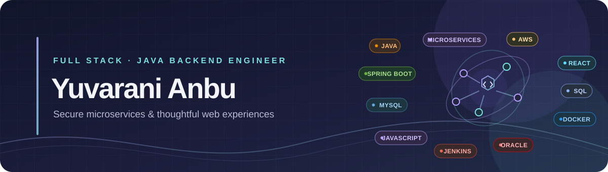

  

   

  
  
  

 

## 👋 About Me

I’m a **Full Stack and Java Backend Engineer** with **five years of experience** architecting secure, resilient and high-performance platforms for the **government and banking sectors**.

Today, I engineer Java 21 and Spring Boot microservices for **DubaiNow**, Dubai’s one-stop app for government services, run by the Dubai Digital Authority. There, I integrate **Dubai Land Department (DLD)**, **DEWA** and **UAE Pass** services to power Ejari tenancy and property journeys used by residents across Dubai.

I enjoy owning features end to end, from API design and data modelling to responsive, accessible interfaces, and I take pride in clean, well-tested code that delivers measurable business outcomes.

> 📍 Dubai, UAE · 💼 Open to Full Stack, Java Backend and Software Engineering opportunities

## 📈 Impact at a Glance

| | |
| :--- | :--- |
| ⚡ **15% faster APIs** | Redis caching and session-management strategy on DubaiNow |
| 🔌 **50+ production REST APIs** | Designed and deployed for regulated core-banking platforms |
| 🔐 **10% less unauthorized access** | Hardened services with Spring Security, OAuth2 and JWT |
| 🚀 **25% shorter deployments** | Streamlined Jenkins and Git CI/CD pipelines |
| 🛡️ **30% fewer production incidents** | Diagnosed and resolved 50+ application defects |
| ✅ **95% on-time delivery** | Across 20+ Agile sprints, with 1,000+ code changes contributed |

## 🧰 Technology Toolkit

  
  
  
  
  
  
  
  
  
  
  
  
  
  
  
  
  

| Focus | Skills |
| --- | --- |
| **Backend engineering** | Java 8/17/21, Spring Boot, Spring MVC, Spring Batch, Spring Data JPA, Hibernate ORM, Maven, Tomcat |
| **Microservices & integration** | RESTful API design, Spring Cloud Gateway, Eureka service discovery, Apache Kafka, Redis, iPaaS gateway integrations |
| **Frontend** | React.js, Redux, JavaScript, Apache FreeMarker (bilingual English/Arabic), Tailwind CSS, Material UI, HTML5, CSS3 |
| **Data** | MySQL, Oracle, MongoDB, SQL query tuning and optimization |
| **Security & quality** | Spring Security, OAuth2, JWT, UAE Pass integration, JUnit, Mockito, Swagger / OpenAPI |
| **Cloud, DevOps & observability** | Docker, Kubernetes, AWS, Jenkins CI/CD, Git & GitHub, Prometheus, Grafana |
| **Ways of working** | Agile / Scrum, JIRA, Postman, IntelliJ IDEA, Spring Tool Suite, VS Code |

## 💼 Professional Experience

### Software Developer · Datacell Solutions · Dubai
*December 2025 – Present*

Full Stack Engineer on **DubaiNow**, the citywide smart-services application of the Dubai Digital Authority (DDA).

- Design and deliver backend services on Java 21, Spring Boot and a microservices architecture, engineered for scalability and long-term maintainability.
- Orchestrate integrations with DLD and DEWA through the iPaaS gateway, incorporating UAE Pass digital signatures and secure online fee collection.
- Lifted API responsiveness by **15%** through a Redis caching and session-management strategy.
- Craft bilingual (English/Arabic) server-rendered user journeys with Apache FreeMarker.
- Partner with DLD and DEWA stakeholders through User Acceptance Testing to resolve defects ahead of each release.

### Software Engineer · Scope e-Knowledge Center · Chennai
*November 2023 – April 2025*

- Drove the modernization of core-banking platforms, designing and deploying **50+ RESTful APIs** on Java 17 and Spring Boot in line with banking regulations.
- Built responsive front-end interfaces with React.js and Tailwind CSS, delivering features end to end across the full stack.
- Hardened the platform with Spring Security, OAuth2 and JWT, reducing unauthorized access by **10%**.
- Built a robust data layer with Spring Data JPA and Hibernate across MySQL and Oracle, tuning complex SQL for throughput and efficiency.
- Enabled resilient, event-driven communication with Apache Kafka and dynamic service discovery with Spring Cloud and Eureka.

### Associate Software Engineer · Scope e-Knowledge Center · Chennai
*March 2021 – November 2023*

- Accelerated release cadence by streamlining Jenkins and Git CI/CD pipelines, shortening deployment cycles by **25%**.
- Strengthened production stability by resolving 50+ defects, contributing to a **30%** decline in production incidents.
- Contributed 1,000+ code changes and helped the team achieve **95%** on-time delivery across 20+ Agile sprints.

## 🏗️ Selected Professional Projects

| Project | Highlights |
| --- | --- |
| 🏠 **DubaiNow – Ejari Services** | End-to-end tenancy registration, renewal and termination for tenants and landlords, featuring guided multi-step journeys, live contract-progress tracking, status-driven Ejari history, UAE Pass digital signing, Ejari fee payment and DEWA activation. |
| 📐 **DubaiNow – Area Modification** | A fully digital property area-modification service with clear guidance and transparent fees, automating site-plan retrieval, DLD payments and the issuance of updated title deeds and receipts. |
| 🏦 **RetailCore** | Legacy core banking re-engineered into an API-first microservices suite covering customer and beneficiary management, address and KYC updates, third-party and external transfers, payment-gateway integration and credit-card services. |
| 📊 **Credix 7.1 – CR Workbench** | Centralized credit analysis and workflow management for retail lending, seamlessly integrating core banking and loan-origination systems. |
| 📚 **DocuNorm** | A secure, workflow-driven e-commerce platform for licensed international standards (ISO, IEC, IEEE, ANSI, ASTM, BIS, DIN, JIS), with search and preview, secure checkout, licence-controlled downloads and an administrative console. |

## 🚀 Open-Source Projects

| Project | What it does |
| --- | --- |
| 🌍 **[GeoPulse](https://github.com/yuvaranianbu27/geopulse)** | An event-driven prototype that ingests real-time driver locations with Java and Apache Kafka. |
| 📒 **[LedgerX](https://github.com/yuvaranianbu27/LedgerX)** | A Java ledger domain foundation modelling accounts, transactions and double-entry journal entries. |
| 🤖 **[Email Reply Genie](https://github.com/yuvaranianbu27/Email-Reply-Genie)** | An AI-powered assistant that drafts thoughtful, tone-aware email replies in seconds. |
| 🛍️ **[YR Store](https://github.com/yuvaranianbu27/YR-Store)** | A full-stack e-commerce application pairing a React storefront with a Spring Boot REST API. |
| 🔐 **[CryptoPulse](https://github.com/yuvaranianbu27/CryptoPulse)** | A cryptocurrency application backend prototype with account management and authentication scaffolding. |

  <a href="https://github.com/yuvaranianbu27?tab=repositories"><strong>Explore all repositories →</strong></a>

## 🎓 Education

**Bachelor of Engineering, Materials Science and Engineering**
College of Engineering, Guindy (CEG), Anna University · Chennai · 2013 – 2017

## 🏅 Certifications

| Credential | Issuer | Earned |
| --- | --- | --- |
| [DubaiNow – UnifyApps Participation Certificate](https://skills.dubai.ae/verification/YXR0YWNobWVudElkPTRhNTNmNTcyLTFlZWEtNGEwNS1hMGVmLTM1MjE2MTcxYjA5NiZsZWFybmluZ0FjdGl2aXR5SWQ9MzUzODcmbGVhcm5lclVzZXJJZD04MDU3Nzg=) | Digital Dubai Authority | June 2026 |
| [Java (Basic)](https://www.hackerrank.com/certificates/96e3dbeda218) | HackerRank | February 2022 |
| [SQL (Basic)](https://www.hackerrank.com/certificates/68b0fb9b76f7) | HackerRank | March 2022 |

## 🤝 Let’s Connect

I’m always glad to talk about full stack and backend engineering, digital-government platforms or new career opportunities. Feel free to reach out.

  
  

 

  Thank you for visiting. Every repository here is a step in a journey of continuous learning.

