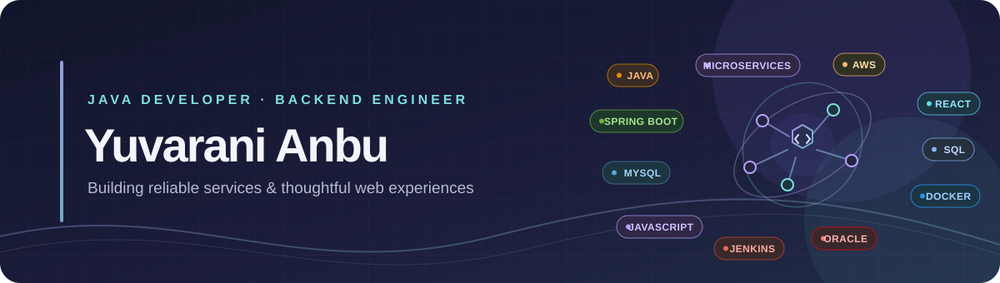

  

   

  
  
  

 

## 👋 About Me

I’m a **Full-Stack Java Developer** with **5 years of hands-on experience** building backend services, integrating APIs, and creating user-focused web applications. I enjoy solving complex technical problems and developing reliable, scalable solutions.

> I work across the stack—from Spring-based services and APIs to clean, intuitive React interfaces.

## 🧰 Technology Toolkit

  
  
  
  
  
  
  
  

| Focus | Skills |
| --- | --- |
| **Backend** | Java, J2EE, Spring Boot, Spring Cloud, Spring Security, REST APIs, microservices |
| **Frontend** | React, JavaScript, HTML, CSS, Material UI, Tailwind CSS |
| **Data & security** | SQL, JWT, OAuth 2.0 |
| **Testing & API tools** | JUnit, Mockito, Swagger, API documentation |
| **Cloud & delivery** | AWS, Docker, Jenkins, Git, Agile/Scrum |
| **Observability** | Prometheus, Grafana, log analysis, troubleshooting |

## 🚀 Featured Projects

| Project | What it does |
| --- | --- |
| 🤖 **[Email Reply Genie](https://github.com/yuvaranianbu27/email-reply-genie)** | An AI-powered assistant for thoughtful, tone-aware email replies. |
| 🛍️ **[YR Store](https://github.com/yuvaranianbu27/Yr-Store)** | A full-stack e-commerce platform focused on a smooth shopping experience. |

  <a href="https://github.com/yuvaranianbu27?tab=repositories"><strong>Explore all repositories →</strong></a>

## 🏅 Certifications

| Credential | Issuer | Earned |
| --- | --- | --- |
| [Java](https://www.hackerrank.com/certificates/96e3dbeda218) | HackerRank | February 2022 |
| [SQL](https://www.hackerrank.com/certificates/68b0fb9b76f7) | HackerRank | March 2022 |
| [DubaiNow - UnifyApps Participation Certificate](https://skills.dubai.ae/verification/YXR0YWNobWVudElkPTRhNTNmNTcyLTFlZWEtNGEwNS1hMGVmLTM1MjE2MTcxYjA5NiZsZWFybmluZ0FjdGl2aXR5SWQ9MzUzODcmbGVhcm5lclVzZXJJZD04MDU3Nzg=) | Digital Dubai Authority | June 2026 |

## 🤝 Let’s Connect

Interested in software development, collaboration, or career opportunities? I’d be happy to connect.

  
  

 

  Thanks for stopping by — feel free to explore my work!

